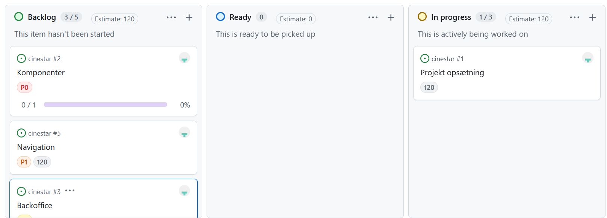

Cinestar - Patryk Michel - WebH125-2, Mediacollege Denmark - 13:40, 31/10/2026

Jeg bekræfter hermed, at jeg selvstændigt og uden uretmæssig hjælp har udviklet det
afleverede eksamensprojekt i overensstemmelse med gældende regler for prøven.

Underskrift
Patryk Michel

## Vurdering af egen indsats

### Hvad gik godt?

Planlægning og brug af dokumentation. Det var vigtigt for mig at gøre en større indsats i forhold til dokumentation, og gjorde mig hurtigt bekvem med arbejdet, når jeg satte en rækkefølge for, hvad der gav mest mening at starte ud med.

Backoffice. Forholdsvis tidligere afleveringer har jeg gjort meget ud af den.

### Hvad var udfordrende, hvordan løste du det?

Dele af CSS'en som overlays og grids. Det trængte til en opfriskning.

Ved et uheld importerede jeg blog komponenten i stedet for blog page som kostede mig tid at fejl finde. Da jeg gennemgik min routes fandt jeg så småfejlen.

### Hvad ville du gøre anderledes?

Holde et konsistent classname mønster. Der er steder i koden, hvor det føles sjusket (i min optik), og hvor jeg havde følt mig tidspresset.

Finpudse siden yderligere hvis jeg havde længere tid.

### Hvordan har du udviklet dig fagligt?

Jeg har fået et bedre forståelse for backoffice implementering og API integration.

## Tidslinje

10/26/2026

Opretter GitHub og issues i min kanban board.
Begynder at dokumenterer arbejdsprocesen.
Implementerer navigation som det første.

10/27/2026

Bliver færdig med min navigation.
Begynder med at kode AuthContext indtil den også er færdig.
Starter at implementere Hero komponent, også færdig.

10/28/2026

Jeg begynder med at lave routes.
Min call to action komponent kodes færdig.
Portfolio kodes færdig.
History kodes færdig
Udtalelser kodes færdig.
Services kodes færdig.

Begynder på at kode CRUD.

10/29/2026

Kontakt laves færdig.
Blog laves færdig.
Footer laves færdig.

10/30/2026

Home page er kodet færdig, jeg tilføjer protected route til min backoffice page og koder den også færdig.

Jeg koder min backoffice færdig, samt tilvalgsopgaven.

10/31/2026

Mangler kun at implementere de resterende sider.
Jeg koder kontakt, faq, blog og blogonepage færdig.

## Tech stack

Projektet er lavet med React og vanilla CSS med en komponentbaseret struktur.

Der er 14 NPM dependencies

cinestar@0.0.0 C:\Web Development\cinestar
├── @eslint/js@10.0.1
├── @types/react-dom@19.3.0
├── @types/react@19.3.0
├── @vitejs/plugin-react@6.1.2
├── eslint-plugin-react-hooks@7.1.1
├── eslint-plugin-react-refresh@0.5.7
├── eslint@10.13.0
├── globals@17.13.0
├── react-dom@19.3.1
├── react-helmet-async@3.0.0
├── react-icons@5.7.0
├── react-router-dom@7.18.4
├── react@19.3.1
└── vite@8.3.5

## Faglige valg og dokumentation

Jeg tog mig en del friheder med stylingen. Jeg undlod at have 3 award images på hero billedet da de to var ens. Det kan virke uprofessionelt.

De fleste sektioner på siden er adskilt med orange borders. Jeg valgte at slette borders, da farven var for meget og kunne genere i en UX kontekst.

Kontakt sektionen har jeg lavet om til en column struktur både på desktop og mobile view. Grid systemet virkede forældet, hvorimod min struktur er lettere at følge med øjnene og er tilrettet vores naturlige læsevaner (altså fra top til bund.)

Newsletteren har ikke et baggrundsbillede, da det gjorde kontrasten mellem teksten og baggrunden svært at læse. Derudover har jeg givet den et Call to Action følelse som fanger opmærksomheden.

Footeren lod jeg blive på alle sider da det sagtens kan føre til tab af potentielle kunde pga, øget friktion.

## Anvendelse af tredjepart

Brugte mine noter og tidligere opgaver for at se om jeg kunne bruge dem til noget.

Rapporten er skrevet færdig den 31/10/2026.
